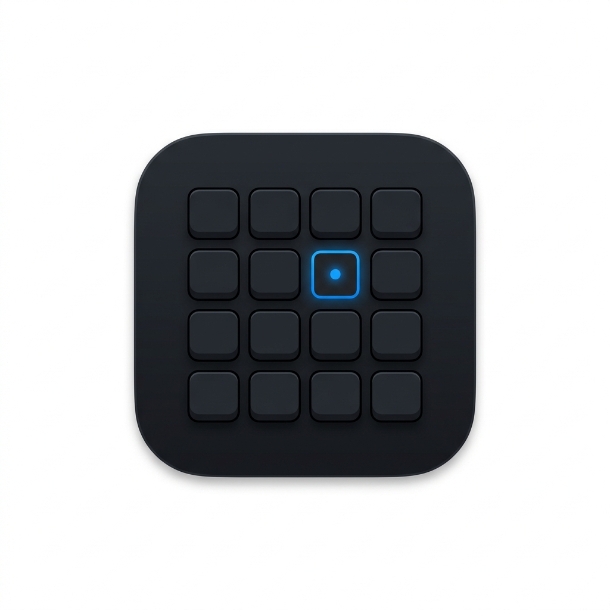

<p align="center">
  
</p>

<h1 align="center">KeyDeck</h1>

<p align="center">
  <strong>Transform your physical numpad into a powerful Stream Deck alternative whenever Num Lock is OFF.</strong>
</p>

<p align="center">
  
  
  
  
  
  
  
  
</p>

<p align="center">
  
</p>

---

## ⚡ Instant Download & Quick Start (Zero Install)

KeyDeck is pre-built as a self-contained, standalone single-file Windows executable with the .NET 8 desktop runtime and native dependencies compressed inside:

1. **Download:** Get the pre-built **[`publish/KeyDeck.exe`](publish/KeyDeck.exe)** directly from this repository.
2. **Run:** Double-click **`KeyDeck.exe`** to start immediately.
   - **No .NET runtime or SDK installation needed.**
   - Sits quietly in your Windows System Tray. Double-click the tray icon to open the configuration dashboard.
   - Toggle **Num Lock OFF** on your keyboard to fire macros! Turn **Num Lock ON** anytime for normal calculator typing.

---

## 💡 What is KeyDeck?

**KeyDeck** is a lightweight, zero-latency, zero-cost Windows utility that transforms any standard physical numeric keypad into an Elgato Stream Deck alternative.

- **Num Lock OFF:** Your 16 numpad keys execute rich custom macros—launching apps, firing hotkeys, opening URLs, controlling media, pasting Unicode text, or chaining multi-action scripts.
- **Num Lock ON:** Your numpad functions normally for standard numeric input, math, and spreadsheet calculations.
- **Dedicated Arrow Protection:** Dedicated navigation and arrow keys (`Insert`, `Delete`, `Home`, `End`, `Page Up`, `Page Down`, Arrow keys) are never intercepted, preserving normal typing and editing workflow.

---

## 🚀 Key Features in v2.0

### 🔄 Per-App Automatic Profile Switching
Link any profile to target application executables (e.g. `devenv.exe`, `obs64.exe`, `photoshop.exe`, `code.exe`). A low-overhead OS event hook (`SetWinEventHook`) automatically detects active window focus changes and switches the active numpad layout instantly.

### ⛓️ Multi-Action Macro Sequencing
Chain multiple actions into an automated pipeline. Mix and match hotkey presses, application launches, text pastes, and millisecond-accurate delay intervals (`10ms` to `10,000ms`).

### 👻 Click-Through Draggable HUD Overlay
Stay in the zone with an unobtrusive, always-on-top transparent HUD mini-deck pinned to your screen:
- **Click-Through:** Never steals window focus or disrupts full-screen games.
- **Draggable & Lockable:** Drag to any preferred screen location, lock its position, or reset with one click.
- **Custom Opacity Slider:** Real-time opacity adjustment from `20%` to `100%`.

### 🖱️ Virtual On-Screen Deck (Click-to-Execute)
No physical numpad? Working on a laptop or touchscreen? Click or double-click any key cell in the KeyDeck UI to fire the macro immediately.

### ⚡ Extended Virtual Keys & Smart Media Repeat
- **Extended Key Support:** Full driver-accurate emulation of navigation keys (`Insert`, `Delete`, `Home`, `End`), arrow keys, and right-hand modifiers (`RControlKey`, `RMenu`) with unmanaged `KEYEVENTF_EXTENDEDKEY` flags.
- **Smart Repeat Filter:** Media volume adjustments (`Volume Up`, `Volume Down`, `Mute`) smoothly allow holding down the physical key, while complex hotkeys and commands are debounce-filtered against accidental triggers.

### 🖼️ Automatic Shell Icon Extraction
Drag-and-drop any `.exe`, `.lnk`, or document directly onto a numpad key to automatically extract its high-resolution Windows shell icon and assign its launch action.

### 🛡️ Atomic Persistence & Fault Tolerance
All user profiles and settings are saved using atomic temporary file swaps (`.tmp` write → atomic replace), ensuring zero configuration corruption during sudden power losses or system reboots. Corrupted profiles are safely quarantined while all valid profiles continue loading.

---

## 🎛️ Supported Action Types

| Action Type | Description | Example Configuration |
|:---|:---|:---|
| **Hotkey** | Fires complex keyboard combinations via unmanaged `SendInput` | `Ctrl + Shift + Esc`, `Alt + F4`, `Win + D` |
| **Launch App** | Starts an executable, shortcut, or document with arguments | `C:\Windows\System32\cmd.exe` |
| **Open URL** | Launches web pages or web apps in your default browser | `https://chatgpt.com`, `https://github.com` |
| **Media Control** | Controls system audio with holding-repeat support | `Play/Pause`, `Next Track`, `Volume Up`, `Mute` |
| **Run Command** | Executes shell commands silently or via terminal | `powershell -NoExit git status` |
| **Paste Text** | Types Unicode strings without altering the system clipboard | Long passwords, email templates, code snippets |
| **Switch Profile** | Instantly switches to another KeyDeck profile from your numpad | Switch between *Gaming*, *Coding*, and *OBS* |
| **Multi-Action** | Chains sequential steps with granular pauses | `Win+R` → `delay 100ms` → `notepad` → `Enter` |
| **System** | Executes common Windows management tasks | `Lock Workstation`, `Sleep`, `Empty Recycle Bin` |

---

## ⌨️ Physical Numpad Hardware Mapping

KeyDeck inspects physical hardware make scancodes and unmanaged `KBDLLHOOKSTRUCT` flags to distinguish numpad keys from dedicated navigation keys:

```
┌──────────────┬──────────────┬──────────────┬──────────────┐
│   Num Lock   │      /       │      *       │      -       │
│ (Indicator)  │ (Scan 0x35)  │ (Scan 0x37)  │ (Scan 0x4A)  │
├──────────────┼──────────────┼──────────────┼──────────────┤
│      7       │      8       │      9       │              │
│ (Scan 0x47)  │ (Scan 0x48)  │ (Scan 0x49)  │      +       │
├──────────────┼──────────────┼──────────────┤ (Scan 0x4E)  │
│      4       │      5       │      6       │              │
│ (Scan 0x4B)  │ (Scan 0x4C)  │ (Scan 0x4D)  │              │
├──────────────┼──────────────┼──────────────┼──────────────┤
│      1       │      2       │      3       │              │
│ (Scan 0x4F)  │ (Scan 0x50)  │ (Scan 0x51)  │    Enter     │
├──────────────┴──────────────┼──────────────┤ (Scan 0x1C)  │
│              0              │      .       │ (Extended 0) │
│         (Scan 0x52)         │ (Scan 0x53)  │              │
└─────────────────────────────┴──────────────┴──────────────┘
```

---

## 🏛️ Clean Architecture & Design

KeyDeck is engineered with strict separation of concerns and modern reactive patterns:

```
┌────────────────────────────────────────────────────────┐
│                        UI Layer                        │
│   MainWindow  •  HudWindow  •  NumpadGrid  •  Themes   │
└───────────────────────────┬────────────────────────────┘
                            │ Observes
                            ▼
┌────────────────────────────────────────────────────────┐
│                  Reactive State Layer                  │
│       AppStateService (IAppStateService, Events)       │
└─────────────┬────────────────────────────┬─────────────┘
              │ Coordinates                │ Dispatches
              ▼                            ▼
┌───────────────────────────┐  ┌─────────────────────────┐
│        Core Domain        │  │ Infrastructure Services │
│ ProfileManager, Executor, │  │ ConfigService (Atomic), │
│ KeyInterceptor, Models    │  │ EnvironmentService, Tray│
└─────────────┬─────────────┘  └─────────────────────────┘
              │ Low-Level Hooks
              ▼
┌────────────────────────────────────────────────────────┐
│                   Platform Win32                       │
│    KeyboardHook, ForegroundAppMonitor, NumLockMonitor  │
└────────────────────────────────────────────────────────┘
```

For complete technical specifications, review the **[KeyDeck Architecture Guide](docs/ARCHITECTURE.md)**.

---

## 🧪 Automated Testing

KeyDeck includes a zero-dependency automated test runner in `tests/KeyDeck.Tests/` executing 27 comprehensive tests across 6 suites:

```bash
# Run all automated tests:
dotnet run --project tests/KeyDeck.Tests/KeyDeck.Tests.csproj -c Release --no-build
```

- **`ActionExecutorTests`:** Unicode chunking math, extended virtual keys, profile delegation.
- **`AppStateServiceTests`:** Reactive state notifications, HUD opacity clamping, profile sync.
- **`ConfigServiceTests`:** Atomic file writing, corrupt profile quarantine, default profile seeding.
- **`HookAndInterceptorTests`:** Num Lock mode toggles, temporary bypass, volume repeat predicates.
- **`ModelTests`:** Profile/Action deep cloning, JSON roundtrip fidelity, default value boundaries.
- **`ProfileManagerTests`:** Profile CRUD, last-profile deletion safeguard, process normalization.

---

## 🛠️ Building & Running

### Prerequisites
- **Windows 10** (Build 19041+) or **Windows 11**
- **[.NET 8.0 SDK](https://dotnet.microsoft.com/download/dotnet/8.0)**

### 1. Clone & Build
```powershell
git clone https://github.com/adityajain-hub/KeyDeck.git
cd KeyDeck
dotnet build KeyDeck.sln -c Release
```

### 2. Run Automated Tests
```powershell
dotnet run --project tests/KeyDeck.Tests/KeyDeck.Tests.csproj -c Release --no-build
```

### 3. Launch KeyDeck
```powershell
dotnet run --project src/KeyDeck/KeyDeck.csproj -c Release --no-build
```
Or launch the compiled binary directly from:
```text
src/KeyDeck/bin/Release/net8.0-windows/KeyDeck.exe
```

### 4. Package Standalone Single-File Release
To bundle the full desktop runtime and create the compressed, zero-dependency executable in `publish/KeyDeck.exe`:
```powershell
.\build-release.ps1
```

---

## ⚙️ Configuration & Storage

KeyDeck stores user configurations in standard Windows AppData:
- **Settings:** `%APPDATA%\KeyDeck\settings.json`
- **Profiles:** `%APPDATA%\KeyDeck\profiles\<profile-id>.json`
- **Icons:** `%APPDATA%\KeyDeck\icons\<sha256>.png`

---

## 📄 License

This project is licensed under the [MIT License](LICENSE).
