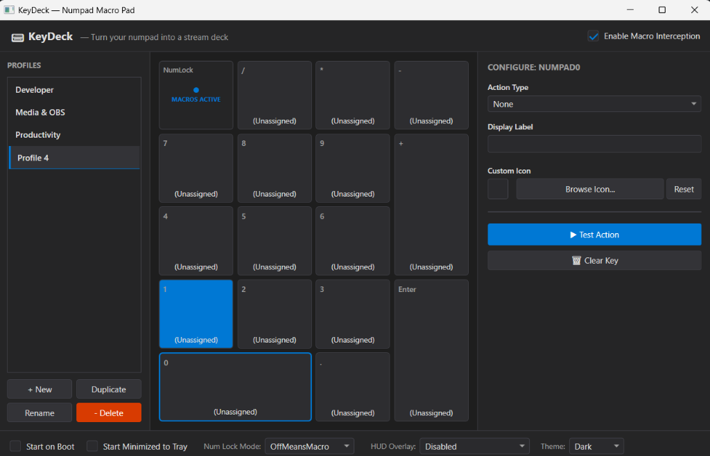

# KeyDeck ⌨️🎛️

<p align="center">
  <strong>Transform your keyboard's numpad into an Elgato Stream Deck alternative whenever Num Lock is OFF.</strong>
</p>

<p align="center">
  
  
  
  
  
</p>

<p align="center">
  
</p>

---

## 💡 Overview

**KeyDeck** is a lightweight, zero-bloat Windows utility that converts your physical numeric keypad into a customizable 16-key macro pad. Whenever **Num Lock is OFF**, physical numpad keys trigger custom actions—launching apps, opening URLs, firing hotkey combinations, running scripts, controlling media, pasting text, or triggering system commands—without affecting your dedicated arrow or navigation keys.

When **Num Lock is ON**, your numpad functions exactly like a standard number pad for calculations and data entry.

KeyDeck also functions as an interactive **virtual on-screen deck** with an always-on-top, click-through transparent HUD overlay.

---

## ✨ Features

- **⚡ Hardware-Accurate Low-Level Interception:**
  Intercepts physical numpad keys at the driver/kernel boundary via low-level Win32 hooks (`WH_KEYBOARD_LL`) checking PS/2 make scan codes and `LLKHF_EXTENDED` flags. Your dedicated Arrow cluster (`Insert`, `Delete`, `Home`, `End`, `Page Up`, `Page Down`, and arrow keys) remains 100% untouched.

- **🎛️ 9 Powerful Macro Action Types:**
  Configure each key to perform single or chained actions with custom labels and icons.

- **🖥️ Beautiful Three-Panel Settings UI:**
  - **Left Panel:** Multi-profile management (create, duplicate, rename, delete).
  - **Center Panel:** Realistic physical 4×5 numpad grid with real-time macro state indicators and visual key flashes.
  - **Right Panel:** Dynamic action configurator with live icon preview and hotkey recorder.

- **🖱️ Virtual On-Screen Deck (Click-to-Execute):**
  Use KeyDeck on touchscreens or laptops without a physical numpad! Double-click any key cell (or click the currently selected key) to fire the macro directly on screen.

- **👻 Transparent Click-Through HUD Overlay:**
  An unobtrusive on-screen mini deck placed at the corner of your monitor displaying active key labels. Features click-through passthrough (won't steal gaming or window focus) and configurable auto-fade modes.

- **🖼️ Auto Icon Extraction & Drag-and-Drop:**
  Drag any `.exe`, `.lnk`, or file directly onto a numpad cell to extract its high-resolution Windows shell icon and automatically configure its launch binding.

- **🔒 Privacy & Clean Architecture:**
  - 100% offline, zero telemetry, zero background network calls.
  - Written in modern C# 12 and .NET 8.
  - Layered architecture with strict separation of Core abstractions, Infrastructure persistence, and UI.

---

## 🚀 Supported Action Types

| Action Type | Description | Configuration Options |
| :--- | :--- | :--- |
| **`LaunchApp`** | Launches executables or opens files with shell associations. | Target path, command-line arguments, working directory. |
| **`OpenUrl`** | Opens any webpage in your default browser. | HTTP/HTTPS URL with auto-formatting and scheme validation. |
| **`OpenFolder`** | Opens directories directly in Windows File Explorer. | Absolute directory path or `%ENVIRONMENT%` variable path. |
| **`Hotkey`** | Fires complex keyboard shortcuts (e.g., `Ctrl+Shift+Esc`). | Recorded physical keys + Win32 virtual key codes. |
| **`RunScript`** | Executes PowerShell (`.ps1`) or Batch (`.bat`) automation scripts. | Script file path, execution arguments. |
| **`MediaControl`** | Direct multimedia control via hardware virtual keys. | Play/Pause, Next Track, Prev Track, Volume Up/Down, Mute. |
| **`SystemAction`** | Windows OS operations. | Lock Workstation, Sleep, Screenshot (Snipping Tool), Empty Recycle Bin, Minimize All. |
| **`TextPaste`** | Instant unicode text emission without destroying clipboard history. | Multiline text strings emitted via synthetic keyboard input. |
| **`MultiAction`** | Sequences multiple sub-actions with millisecond delays. | Chained list of sub-actions with configurable step delays. |

---

## 🏗️ Architecture & Project Structure

The project adheres to Clean Architecture principles, ensuring complete decoupling between hardware hooks, persistence, and UI components:

```text
KeyDeck/
├── KeyDeck.sln
├── README.md
├── LICENSE
└── src/
    └── KeyDeck/
        ├── Core/
        │   ├── Abstractions/             # Interfaces (IConfigService, IProfileManager, IActionExecutor)
        │   ├── Models/                   # Domain entities (Profile, KeyAction, AppSettings, Enums)
        │   ├── ActionExecutor.cs         # Macro execution engine (handles all 9 action types)
        │   ├── IconExtractor.cs          # Shell icon extraction with SHA-256 caching
        │   ├── KeyInterceptor.cs         # Numpad & NumLock macro state coordinator
        │   ├── NumLockMonitor.cs         # Win32 hardware toggle detection & fallback poller
        │   └── ProfileManager.cs         # Active profile manager & event aggregator
        ├── Infrastructure/
        │   ├── Config/
        │   │   └── AppConstants.cs       # Central application constants, registry & mutex keys
        │   ├── ConfigService.cs          # Atomic JSON profile persistence (%APPDATA%\KeyDeck)
        │   ├── HashHelper.cs             # Cryptographic hashing utility
        │   ├── HotkeyRecorder.cs         # WPF key event to Win32 VK mapper
        │   ├── StartupService.cs         # Windows HKCU Run registry manager
        │   └── TrayIconService.cs        # WinForms NotifyIcon with custom GDI+ rendered tray icon
        ├── Platform/
        │   └── Win32/
        │       ├── KeyboardHook.cs       # Low-level WH_KEYBOARD_LL hook & scan code filter
        │       ├── NativeMethods.cs      # P/Invoke signatures (user32, kernel32, shell32)
        │       └── WindowHelper.cs       # Extended window styles (WS_EX_TRANSPARENT, click-through)
        └── UI/
            ├── Controls/
            │   ├── ActionEditor.xaml     # Dynamic right-panel action property inspector
            │   ├── NumpadGrid.xaml       # Physical 4×5 Numpad layout & key cell matrix
            │   ├── NumpadKeyCell.xaml    # Individual interactive key cell
            │   ├── ProfileListPanel.xaml # Profile management list & action buttons
            │   └── PromptDialog.xaml     # Themed input dialog for profile names
            ├── HudOverlay/
            │   └── HudWindow.xaml        # Floating, transparent, click-through desktop overlay
            ├── Resources/
            │   ├── Themes/               # Handcrafted Dark & Light XAML theme dictionaries
            │   └── default-profile.json  # Seed configuration
            ├── App.xaml / App.xaml.cs    # Composition root & single-instance mutex enforcement
            └── MainWindow.xaml           # Main application window shell
```

---

## ⌨️ Physical Keypad Mapping

KeyDeck maps the physical 17-key numpad grid according to hardware scan codes:

```text
┌──────────────┬──────────────┬──────────────┬──────────────┐
│   NumLock    │      /       │      *       │      -       │
│ (Indicator)  │ [Divide: 35] │ [Mult: 37]   │ [Sub: 4A]    │
├──────────────┼──────────────┼──────────────┼──────────────┤
│      7       │      8       │      9       │              │
│  [Scan: 47]  │  [Scan: 48]  │  [Scan: 49]  │      +       │
├──────────────┼──────────────┼──────────────┤  [Add: 4E]   │
│      4       │      5       │      6       │              │
│  [Scan: 4B]  │  [Scan: 4C]  │  [Scan: 4D]  │              │
├──────────────┼──────────────┼──────────────┼──────────────┤
│      1       │      2       │      3       │              │
│  [Scan: 4F]  │  [Scan: 50]  │  [Scan: 51]  │    Enter     │
├──────────────┴──────────────┼──────────────┤ [Enter: 1C]  │
│              0              │      .       │              │
│         [Scan: 52]          │  [Dec: 53]   │              │
└─────────────────────────────┴──────────────┴──────────────┘
```

> **Note on Arrow Keys:** Dedicated arrow and navigation keys (`Left`, `Right`, `Up`, `Down`, `Home`, `End`, `Page Up`, `Page Down`, `Insert`, `Delete`) share identical virtual key codes with numpad keys when NumLock is OFF, but are flagged as `LLKHF_EXTENDED` by the keyboard controller. KeyDeck checks this bit flag and passes them straight through so your navigation cursor never gets hijacked.

---

## 🛠️ Building & Running

### Prerequisites
- Windows 10 (Build 19041+) or Windows 11
- [.NET 8.0 SDK](https://dotnet.microsoft.com/download/dotnet/8.0)

### Clone & Build
```bash
git clone https://github.com/adityajain-hub/KeyDeck.git
cd KeyDeck/src/KeyDeck
dotnet build -c Release
```

### Run
```bash
dotnet run -c Release
```
Or run the compiled executable located at:
```text
src/KeyDeck/bin/Release/net8.0-windows/KeyDeck.exe
```

---

## ⚙️ Configuration & Storage

KeyDeck stores user data in standard Windows AppData:
- **Settings:** `%APPDATA%\KeyDeck\settings.json`
- **Profiles:** `%APPDATA%\KeyDeck\profiles\<profile-id>.json`
- **Extracted Icons:** `%APPDATA%\KeyDeck\icons\<sha256>.png`

All files are written using atomic file swaps (`.tmp` → atomic replace) to ensure zero profile corruption in the event of an unexpected power failure.

---

## 🤝 Contributing

Contributions, bug reports, and feature requests are welcome!
1. Fork the repository.
2. Create your feature branch (`git checkout -b feature/cool-new-feature`).
3. Commit your changes (`git commit -m 'feat: add cool new feature'`).
4. Push to the branch (`git push origin feature/cool-new-feature`).
5. Open a Pull Request.

---

## 📄 License

This project is licensed under the MIT License — see the [LICENSE](LICENSE) file for details.
